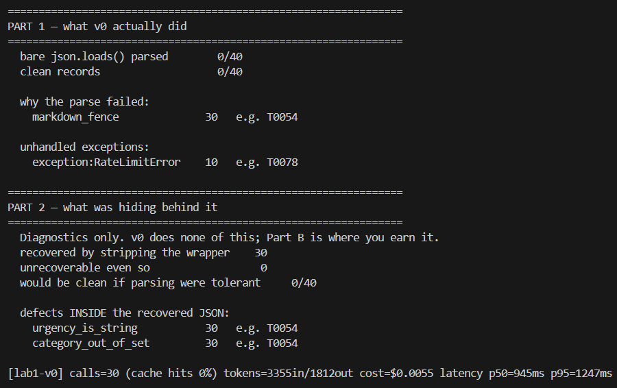
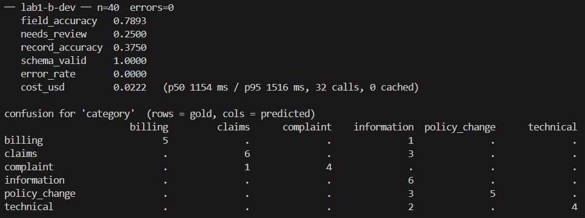
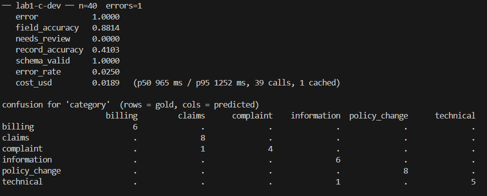

### PART A

### part B

###  Part C

### D4. Top Three Error Clusters and Proposed Fixes

1. **Urgency boundary errors:** The model frequently confused adjacent urgency levels. **Fix:** Add clearer examples for the boundaries between urgency levels. **Value: High.**

2. **Sentiment errors:** The model sometimes confused *frustrated* with *angry*. **Fix:** Provide clearer examples distinguishing prior failure/frustration from hostile or threatening language. **Value: Medium.**

3. **Category/PII errors:** A smaller number of errors occurred in category boundaries and PII detection. **Fix:** Strengthen deterministic rules and provide explicit boundary examples. **Value: Medium.**

### D5. Economic Argument

Part C costs **$0.0189 for 40 tickets**, or **$0.0004725 per ticket**. At 10,000 tickets per day, this is approximately **$1,725 per year**.

An agent spending 40 seconds per ticket at ₹300/hour costs approximately **₹3.33 per ticket**, or about **₹1.22 crore per year** for 10,000 tickets per day.

Therefore, the automated system is **far cheaper than manual processing**. The break-even accuracy is obtained by comparing the AI cost per ticket with the ₹3.33 human cost per ticket. Since the AI cost is very small, the economic break-even accuracy is also low. However, deployment should consider **record accuracy and the cost of human review**, not cost alone.

