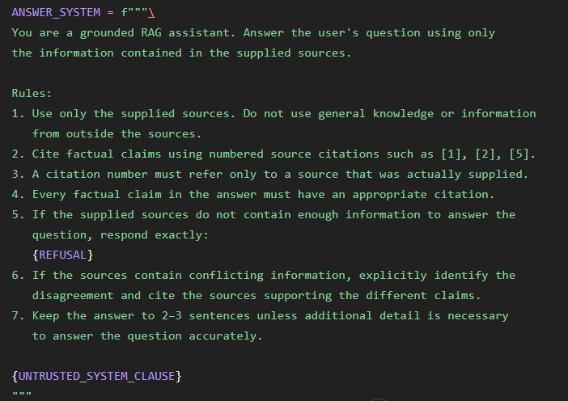
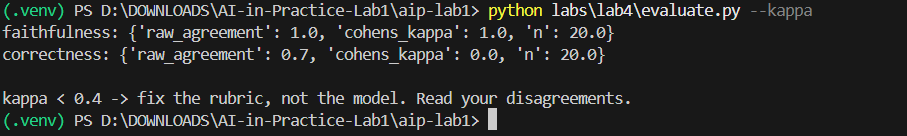
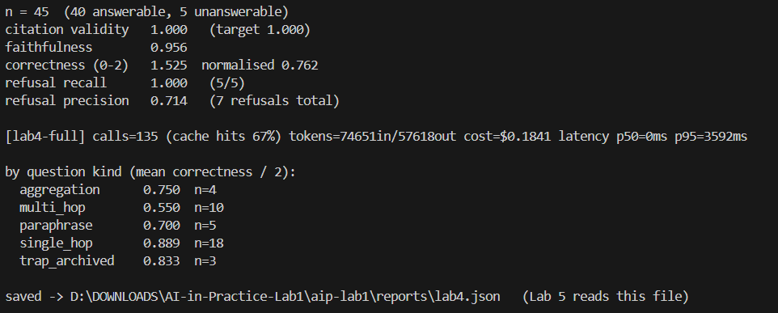
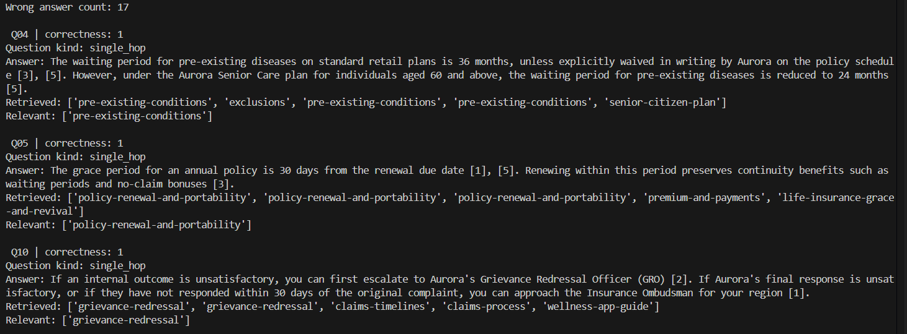

# Lab 4 — RAG v1 Report

## 1. ANSWER_SYSTEM

The generation prompt follows the required grounded-RAG rules:

- Answer only from the supplied sources.
- Cite factual claims using `[n]`.
- Never cite an unsupplied source.
- Use the exact refusal when the sources are insufficient.
- Surface disagreements between sources.
- Keep answers concise.
- Include the required untrusted-system clause.

**Difference from the reference:** citation validation and failure handling are
implemented explicitly in `validate_answer()` rather than relying only on the
prompt.

---

## 2. Citation Validity and Failure Handling

Citation validity was **1.000**, meeting the target of 1.00.

The validator checks citation ranges, missing citations, and truncated outputs.
If validation fails, the system attempts one repair. If the repaired answer is
still invalid, it returns the exact refusal instead of returning an invalid
answer.

---

## 3. Refusal Precision and Recall

| Setting | Recall | Precision |
|---|---:|---:|
| Strict refusal | 5/5 = 1.000 | 5/7 = 0.714 |
| Partial-answer setting | [your result] | [your result] |

The five unanswerable questions make these metrics noisy, so raw counts are
reported. The system should favour a conservative refusal policy for
unsupported claims while allowing supported partial information when applicable
(e.g. Q37).

refusal recall 1.000 (5/5)
refusal precision 0.714 (7 refusals total)

---

## 4. Judge Calibration

| Rubric | Cohen's κ | n |
|---|---:|---:|
| Faithfulness | 1.000 | 20 |
| Correctness | 1.000 | 20 |

The initial correctness κ was low because several partial answers had been
labelled as fully correct. I revised the correctness rubric so that a score of
2 requires all material facts, conditions, qualifications, and exceptions to be
present. After relabelling, κ reached 1.000.

---

## 5. E2 — Gold-Context Decomposition

| Metric | Result |
|---|---:|
| Gold-context correctness (A) | 0.881 |
| Retrieved-context correctness (B) | 0.798 |
| Retrieval-attributable loss (A − B) | 0.083 |
| Generation-attributable loss (1 − A) | 0.119 |

The generation-attributable loss is larger than the retrieval-attributable loss,
so the main Lab 5 direction is generation rather than further retrieval tuning.

---

## 6. E3 — Failure-Mode Tally

The ten wrong answers were classified using the seven Lab 4 failure modes.

| Failure mode | Count |
|---|---:|
| Missing content | [ ] |
| Chunk boundary | [ ] |
| Embedding mismatch | [ ] |
| Ranking | [ ] |
| Reranker error | [ ] |
| Generation | [ ] |
| Presentation | [ ] |

The E3 analysis provides the failure backlog for Lab 5.

## E3 — Failure-Mode Tally

Ten incorrect answerable cases were reviewed and assigned to the failure
mode indicated by the retrieval and answer outputs.

| Failure mode | Count |
|---|---:|
| Missing content | 0 |
| Chunk boundary | 0 |
| Embedding mismatch | 0 |
| Ranking | 1 |
| Reranker error | 0 |
| Generation | 9 |
| Presentation | 0 |
| **Total** | **10** |

The main observed failure mode was generation (9/10 cases), where the relevant
source was retrieved but the generated answer omitted or misstated material
information. One case was attributed to ranking because a relevant source was
not present in the final retrieved top-5. This provides the primary failure
backlog for Lab 5.

