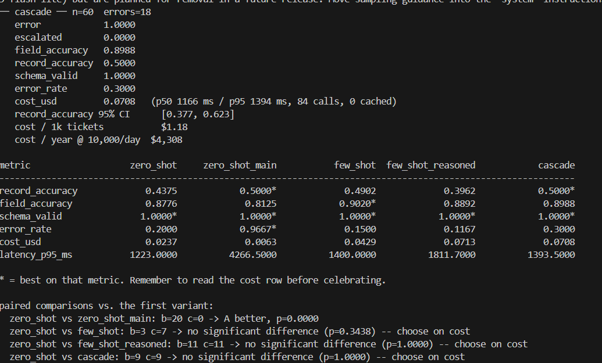
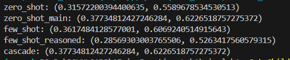
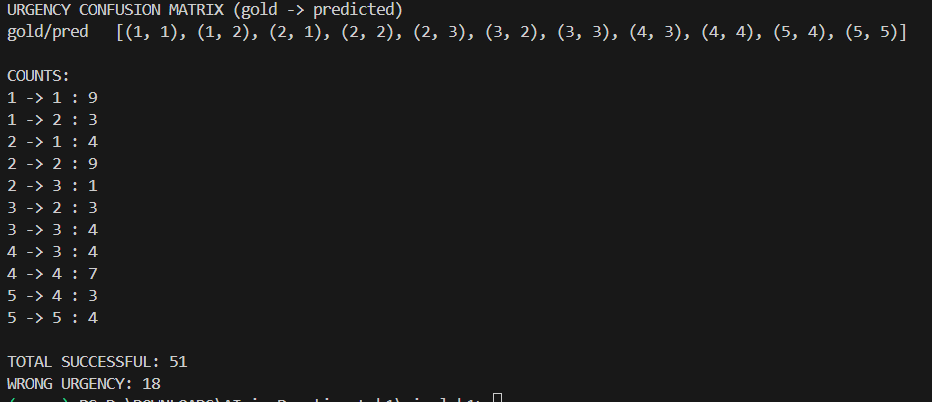

part A:

| Ticket | Reason for selection              |
| ------ | --------------------------------- |
| T0097  | Billing/complaint boundary        |
| T0054  | Missing policy number → `null`    |
| T0200  | Hinglish / mixed language         |
| T0222  | Sentiment vs. urgency distinction |
| T0238  | Quoted reply vs. current evidence |
| T0214  | Difficult mis-selling complaint   |

part b and c:

part d:

part e:

