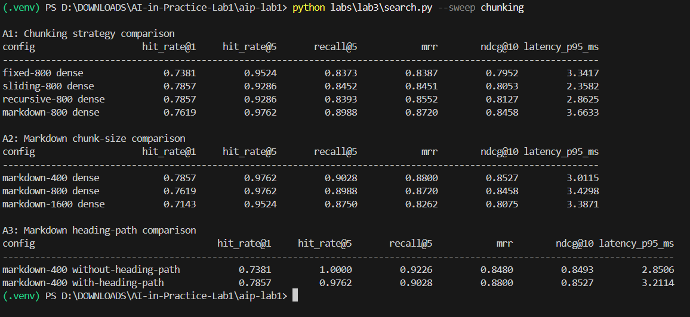
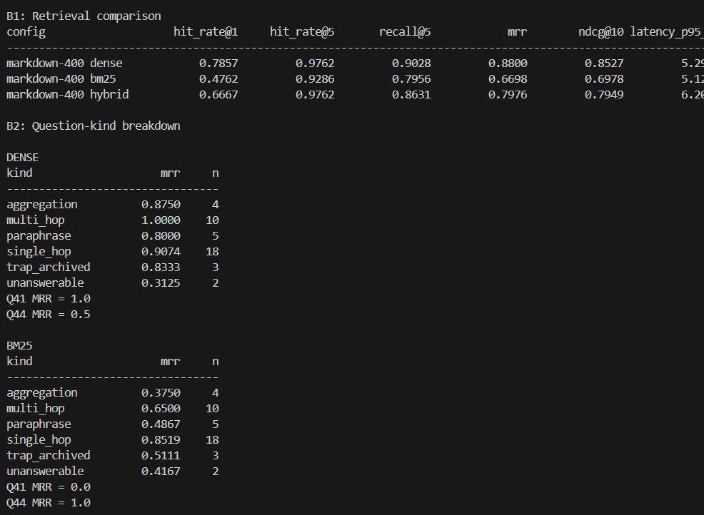
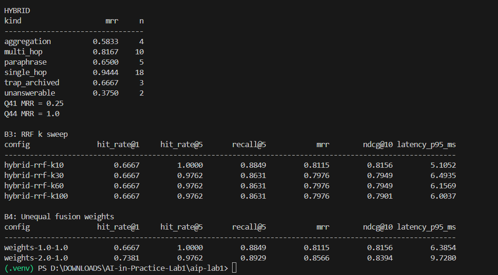
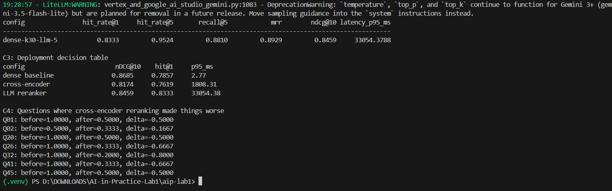
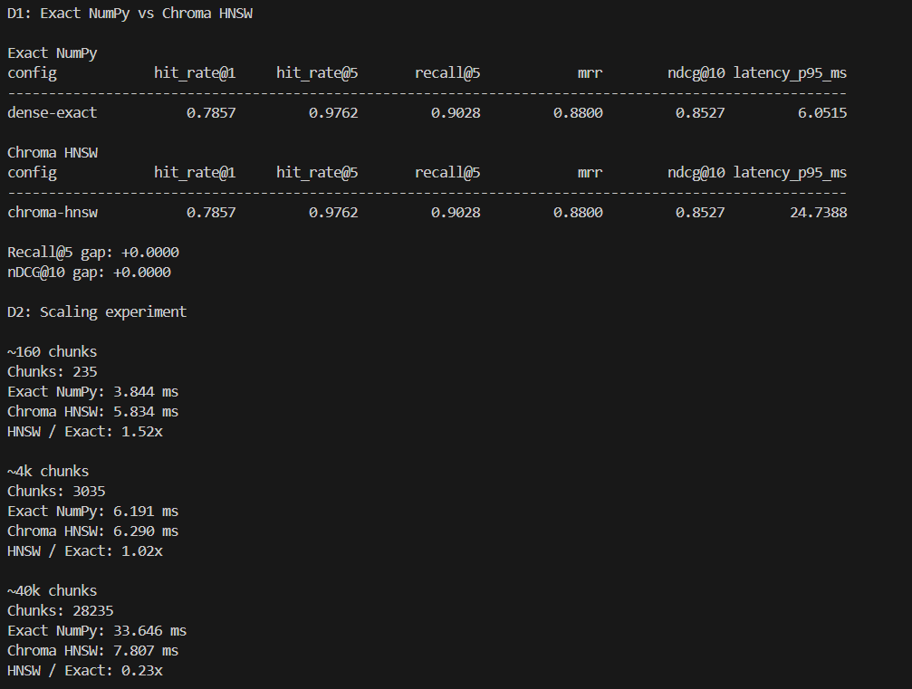
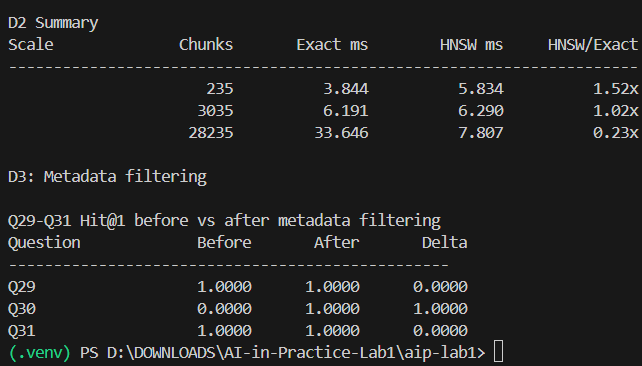

1. Chunking table + size curve, with dilution explanation
Markdown-aware chunking performed best among the tested strategies.
Markdown-400 was the selected size, with nDCG@10 = 0.8527, compared with 0.8458 at 800 and 0.8075 at 1600.
Larger chunks dilute the embedding with less relevant information, making the representation less specific to the query.
2. Retrieval table broken down by question kind
Dense retrieval performed best overall on this corpus.
Performance varied by question kind:
Dense was strong on multi-hop (1.0000 MRR) and single-hop (0.9074).
BM25 was strongest for lexical/identifier-style retrieval.
Hybrid did not improve overall retrieval quality over dense retrieval.
3. Q44/Q41 analysis
Q41: Dense MRR = 1.0, BM25 MRR = 0.0. This shows the advantage of semantic retrieval for paraphrased queries.
Q44: BM25 MRR = 1.0, Dense MRR = 0.5. This shows the advantage of lexical matching for identifier-style queries.
4. Reranking decision table + two deployment answers
Cross-encoder: nDCG@10 decreased from 0.8685 to 0.8174 and p95 latency increased to 1808.31 ms.
LLM reranker: nDCG@10 = 0.8459, Hit@1 = 0.8333, but p95 latency was 33,054.38 ms.

Interactive deployment: Avoid the LLM reranker because ~33 seconds p95 is too expensive for interactive response time; the dense baseline has much lower latency.

Overnight/batch deployment: The LLM reranker is technically viable because very high latency is less restrictive for offline processing, so its additional ranking step can be accommodated when throughput/latency requirements are relaxed.

5. Metadata filter Q29–Q31
Question	Before	After
Q29	1.0	1.0
Q30	0.0	1.0
Q31	1.0	1.0

Metadata filtering therefore fixed Q30 without changing the underlying retriever.

6. Final configuration and numbers

Your selected configuration is:

Markdown-400 + heading path + dense retrieval

Results:

Hit@1: 0.7857
Hit@5: 0.9762
Recall@5: 0.9028
MRR: 0.8800
nDCG@10: 0.8527
p95 latency: approximately 2.93 ms in the Part A/B run.
7. One surprising result

A surprising result was that hybrid retrieval did not outperform dense retrieval. Dense achieved nDCG@10 = 0.8527, while hybrid achieved 0.7949. Combining lexical and semantic retrieval therefore did not automatically improve ranking quality on this corpus.

8. Why Q36/Q38/Q39 were excluded

Q36, Q38, and Q39 were unanswerable questions with no relevant documents in the gold data. Recall is undefined for these questions, producing NaN values. Therefore, they were excluded from retrieval-quality metrics such as recall, leaving 42 answerable questions.

9. What greedy one-axis-at-a-time sweeping can miss

Greedy sweeping can miss a better overall configuration because the parameters interact. Optimizing one axis while holding the others fixed can select a locally good setting that is not part of the best joint combination.

